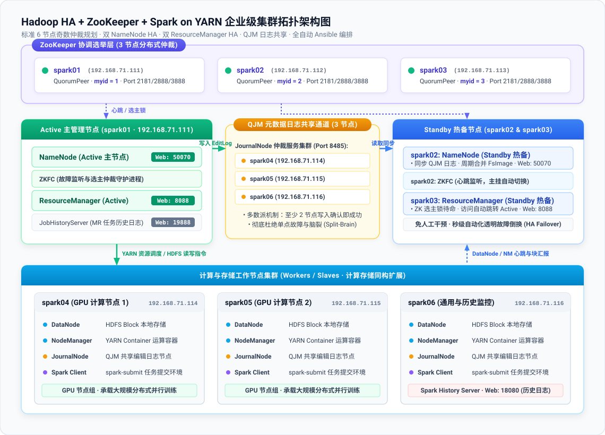
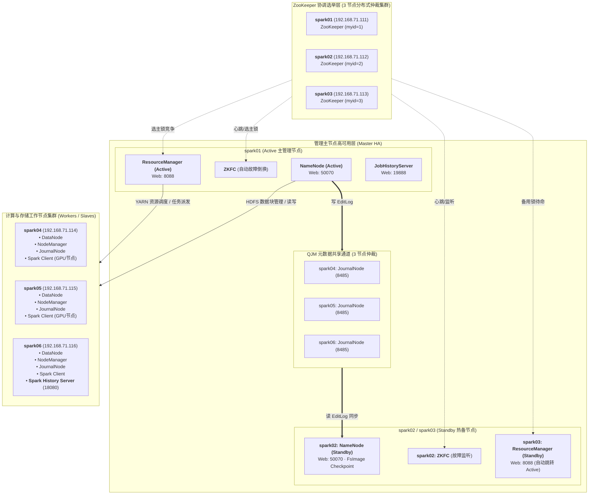

# Enterprise Hadoop HA + Spark on YARN + ZooKeeper Ansible Deployment

[](LICENSE)
[](https://www.ansible.com/)
[](https://hadoop.apache.org/)
[](https://spark.apache.org/)
[](https://zookeeper.apache.org/)

一套**生产级、完全纯离线可用、幂等安全**的 Ansible 大数据集群自动化部署项目。

本项目严格对齐标准生产级高可用架构，集成了 **HDFS NameNode HA（QJM + ZKFC 自动故障倒换）**、**YARN ResourceManager HA（ZKRMStateStore 状态持久化）**、**3 节点分布式 ZooKeeper 协调集群** 以及 **Spark on YARN（Client / Cluster 双模式）**，并内置了针对计算节点的 **YARN 内存与 CPU 资源倾斜优化配置**。

> 📘 **企业级生产落地推荐**：针对多盘 JBOD 存储挂载、JVM G1GC 生产级堆内存调优、时钟防脑裂及元数据容灾备份，请参阅：
> - [生产环境部署与落地运维实战指南](docs/production-deployment-guide.md)
> - [上线前置体检工具](scripts/preflight_check.sh)：`bash scripts/preflight_check.sh`
> - [元数据自动灾备工具](scripts/backup_cluster_metadata.sh)：`bash scripts/backup_cluster_metadata.sh`

---

## 目录

- [一、集群拓扑与角色规划](#一集群拓扑与角色规划)
- [二、软件版本与离线包规格](#二软件版本与离线包规格)
- [三、工程目录架构](#三工程目录架构)
- [四、快速开始（四步离线构建）](#四快速开始四步离线构建)
  - [1. 准备离线安装包](#1-准备离线安装包)
  - [2. 配置主机清单与网络环境](#2-配置主机清单与网络环境)
  - [3. 一键配置全节点 SSH 双向免密](#3-一键配置全节点-ssh-双向免密)
  - [4. 执行 Ansible 一键部署](#4-执行-ansible-一键部署)
- [五、集群运维管理与日常启停](#五集群运维管理与日常启停)
- [六、服务端口与 Web 控制台速查](#六服务端口与-web-控制台速查)
- [七、冒烟测试与功能验证](#七冒烟测试与功能验证)
- [八、关键技术细节与调优解析](#八关键技术细节与调优解析)
- [九、常见问题排错 (FAQ)](#九常见问题排错-faq)
- [十、开源许可](#十开源许可)

---

## 一、集群拓扑与角色规划

集群基于 6 台主机进行规划（奇数分布式法定人数保障），各节点角色分工如下：



<details>
<summary><b>📐 点击展开 Mermaid 矢量拓扑图代码</b></summary>



</details>

| 主机名 | 默认 IP | 规划承载组件角色 | 说明 |
|---|---|---|---|
| **spark01** | `192.168.71.111` | ZooKeeper (myid=1), NameNode(Active), ZKFC, ResourceManager(Active), JobHistoryServer | 管理主节点 1 |
| **spark02** | `192.168.71.112` | ZooKeeper (myid=2), NameNode(Standby), ZKFC | 管理主节点 2 (热备) |
| **spark03** | `192.168.71.113` | ZooKeeper (myid=3), ResourceManager(Standby) | 管理主节点 3 (YARN热备) |
| **spark04** | `192.168.71.114` | JournalNode, DataNode, NodeManager, Spark Client | 计算/存储/共享节点 1 |
| **spark05** | `192.168.71.115` | JournalNode, DataNode, NodeManager, Spark Client | 计算/存储/共享节点 2 |
| **spark06** | `192.168.71.116` | JournalNode, DataNode, NodeManager, Spark Client, Spark History Server | 计算/存储/共享节点 3 |

---

## 二、软件版本与离线包规格

本项目为**纯离线化**设计，控制节点分发解压，不依赖外网连接。所需安装包统一放置在 `packages/` 目录下：

| 组件名称 | 官方/标准文件名 | 部署版本 | 默认安装路径 |
|---|---|:---:|---|
| **Oracle JDK** | `jdk-8u202-linux-x64.tar.gz` | `8u202` | `/home/software/jdk1.8.0_202` |
| **Scala** | `scala-2.11.12.tgz` | `2.11.12` | `/home/software/scala-2.11.12` |
| **Apache ZooKeeper** | `apache-zookeeper-3.8.4-bin.tar.gz` | `3.8.4` | `/usr/local/apache-zookeeper-3.8.4-bin` |
| **Apache Hadoop** | `hadoop-2.10.1.tar.gz` | `2.10.1` | `/home/software/hadoop-2.10.1` |
| **Apache Spark** | `spark-2.4.8-bin-hadoop2.7.tgz` | `2.4.8` | `/home/software/spark-2.4.8-bin-hadoop2.7` |

> **注意**：ZooKeeper 必须使用带 `-bin.tar.gz` 的二进制包，否则会报 `无法加载主类 QuorumPeerMain`。

---

## 三、工程目录架构

```
hadoop-spark-ansible/
├── .gitignore                      # 忽略 *.tar.gz, *.tgz 等大文件，保障 Git 推送合规
├── LICENSE                         # Apache-2.0 开源许可
├── README.md                       # 项目完整中文使用文档
├── ansible.cfg                     # Ansible 优化配置 (关闭主机密钥检查，启用 pipelining)
├── inventory/
│   ├── hosts.yml                   # 标准 YAML 主机角色清单 (分角色/分组配置)
│   ├── hosts-3nodes.yml            # 3 节点轻量混合高可用清单
│   └── group_vars/
│       ├── all.yml                 # 全局核心配置变量 (目录、端口、内存/CPU调优)
│       └── gpu_nodes.yml           # GPU 节点微调变量
├── packages/
│   ├── .gitkeep
│   └── README.md                   # 离线包下载与放置指引
├── scripts/
│   ├── download_packages.sh        # 在有外网环境下的一键下载辅助脚本
│   ├── setup_ssh_keys.sh           # 自动化配置 6 节点 36 次全双向 SSH 免密互信
│   └── verify_cluster.sh           # 快速运行 JPS 与 Web 端口连通性检查
├── playbooks/
│   ├── 00-system-init.yml          # 阶段 0: 防火墙/SELinux/hosts/系统限制
│   ├── 01-deploy-java-scala.yml    # 阶段 1: JDK 8 与 Scala 2.11 离线解压与环境加载
│   ├── 02-deploy-zookeeper.yml     # 阶段 2: ZooKeeper 集群配置、myid注入与服务启动
│   ├── 03-deploy-hadoop.yml        # 阶段 3: Hadoop HA 分发、配置渲染与安全初始化
│   ├── 04-deploy-spark.yml         # 阶段 4: Spark on YARN 配置与 HistoryServer 部署
│   ├── site.yml                    # 【一键全量部署】主入口剧本
│   ├── cluster-control.yml         # 【集群生命周期管理】start / stop / restart / status
│   └── smoke-test.yml              # 【冒烟测试】HDFS读写 + MR Pi + Spark on YARN 验证
└── roles/
    ├── common/tasks/main.yml       # 操作系统基础加固
    ├── java/tasks/main.yml         # JDK 8 离线解压与环境变量
    ├── scala/tasks/main.yml        # Scala 2.11 离线解压与环境变量
    ├── zookeeper/                  # ZooKeeper 角色 (zoo.cfg.j2 + zookeeper.service.j2)
    ├── hadoop/                     # Hadoop HA 角色 (XML 模板 + 初始化状态机)
    └── spark/                      # Spark on YARN 角色 (客户端配置 + HDFS jar分发)
```

---

## 四、快速开始（四步离线构建）

### 1. 准备离线安装包

将上述 5 个 `.tar.gz` / `.tgz` 安装包放入 `packages/` 目录下。

如果你的控制机具备外网访问权限，可运行脚本自动拉取开源组件（JDK 8 需手工下载）：
```bash
bash scripts/download_packages.sh
```

确保 `packages/` 目录下存在：
```bash
ls -lh packages/
# 应包含:
# apache-zookeeper-3.8.4-bin.tar.gz
# hadoop-2.10.1.tar.gz
# jdk-8u202-linux-x64.tar.gz
# scala-2.11.12.tgz
# spark-2.4.8-bin-hadoop2.7.tgz
```

### 2. 配置主机清单与网络环境

项目内置了两种标准 YAML 拓扑清单供自由选择：
- **`inventory/hosts.yml`**：标准 **6 节点生产解耦模式**（管理与计算存储分离）。
- **`inventory/hosts-3nodes.yml`**：轻量 **3 节点混合高可用模式**（适合笔记本/轻量服务器实验，管理与数据混部，最小化资源占用）。

根据实际服务器 IP 修改所选文件中的主机地址（以 `inventory/hosts.yml` 为例）：
```yaml
all:
  children:
    all_nodes:
      hosts:
        spark01:
          ansible_host: 192.168.71.111
          myid: 1
          nn_id: nn1
          rm_id: rm1
        spark02:
          ansible_host: 192.168.71.112
          myid: 2
          nn_id: nn2
        ...
```

### 3. 一键配置全节点 SSH 双向免密

运行脚本，打通控制机及 6 台主机之间的全网免交互互信（包含 `StrictHostKeyChecking no`）：
```bash
bash scripts/setup_ssh_keys.sh
```

### 4. 执行 Ansible 一键部署

在项目根目录下执行全局入口剧本：
```bash
ansible-playbook playbooks/site.yml
```

> **提示（分步调试）**：你也可以按阶段单独执行各个剧本：
> ```bash
> ansible-playbook playbooks/00-system-init.yml
> ansible-playbook playbooks/01-deploy-java-scala.yml
> ansible-playbook playbooks/02-deploy-zookeeper.yml
> ansible-playbook playbooks/03-deploy-hadoop.yml
> ansible-playbook playbooks/04-deploy-spark.yml
> ```

---

## 五、集群运维管理与日常启停

本项目提供标准化运维剧本 `playbooks/cluster-control.yml`，自动严格按照依赖顺序处理启停：

- **查看集群全部节点进程**：
  ```bash
  ansible-playbook playbooks/cluster-control.yml -e "action=status"
  ```
- **启动集群全体服务**（ZooKeeper -> HDFS -> YARN -> Spark History）：
  ```bash
  ansible-playbook playbooks/cluster-control.yml -e "action=start"
  ```
- **停止集群全体服务**（Spark History -> YARN -> HDFS -> ZooKeeper）：
  ```bash
  ansible-playbook playbooks/cluster-control.yml -e "action=stop"
  ```
- **一键重启集群**：
  ```bash
  ansible-playbook playbooks/cluster-control.yml -e "action=restart"
  ```

---

## 六、服务端口与 Web 控制台速查

Windows 或宿主机请在 `hosts` 文件中增加域名映射（`C:\Windows\System32\drivers\etc\hosts`）：
```
192.168.71.111 spark01
192.168.71.112 spark02
192.168.71.113 spark03
192.168.71.114 spark04
192.168.71.115 spark05
192.168.71.116 spark06
```

访问对应 Web UI：

| 服务组件 | 访问 URL | 说明 |
|---|---|---|
| **Active NameNode** | `http://192.168.71.111:50070` | HDFS 主节点状态、浏览文件系统 |
| **Standby NameNode** | `http://192.168.71.112:50070` | HDFS 备节点状态 |
| **Active YARN RM** | `http://192.168.71.111:8088` | YARN 资源管理与运行中 Application 列表 |
| **Standby YARN RM** | `http://192.168.71.113:8088` | YARN 备用 RM（访问会自动重定向至 Active） |
| **MR JobHistory** | `http://192.168.71.111:19888` | MapReduce 历史任务记录 |
| **Spark History Server** | `http://192.168.71.116:18080` | 查看 Spark 任务 DAG 图、Stage 与事件日志 |

---

## 七、冒烟测试与功能验证

### 1. 执行自动化冒烟剧本

运行预置的端到端冒烟测试：
```bash
ansible-playbook playbooks/smoke-test.yml
```
该剧本会自动完成：
1. **HDFS 写入与读取**：创建 `/tmp/smoke_test` 并校验数据。
2. **MapReduce 计算**：在 YARN 上执行 `hadoop-mapreduce-examples` 计算 $\pi$ 值。
3. **Spark on YARN 提交**：以 YARN Client 模式提交 `JavaSparkPi` 任务。

### 2. 生产实战：提交 PySpark 词频统计 (WordCount)

登录任意 Spark 客户端机器（如 `spark04`）：
```bash
# 1. 准备待统计测试数据并上传至 HDFS
cat > /tmp/textfile.txt << EOF
hello spark
hello hadoop
hello zookeeper
welcome to ansible bigdata automation
EOF

hdfs dfs -mkdir -p /user/wordcount/input
hdfs dfs -put -f /tmp/textfile.txt /user/wordcount/input/

# 2. 编写 PySpark 脚本 word_count.py
cat > /tmp/word_count.py << 'EOF'
from pyspark import SparkContext, SparkConf

conf = SparkConf().setAppName("WordCount").setMaster("yarn")
sc = SparkContext(conf=conf)

rdd = sc.textFile("hdfs://ns/user/wordcount/input/textfile.txt")
word_counts = rdd.flatMap(lambda line: line.split(" ")) \
                 .map(lambda word: (word, 1)) \
                 .reduceByKey(lambda a, b: a + b)

word_counts.saveAsTextFile("hdfs://ns/user/wordcount/output/res")
sc.stop()
EOF

# 3. 以 YARN Cluster 集群模式提交任务
export HADOOP_CONF_DIR=/home/software/hadoop-2.10.1/etc/hadoop
spark-submit --master yarn --deploy-mode cluster /tmp/word_count.py

# 4. 查看计算结果
hdfs dfs -cat /user/wordcount/output/res/part-*
```

---

## 八、关键技术细节与调优解析

### 1. Hadoop 2.10.1 关键兼容差异
- **从节点定义**：使用 `etc/hadoop/slaves`，而非 3.x 的 `workers`。
- **Web UI 端口**：NameNode 默认 Web 端口为 `50070`，DataNode 为 `50075`（3.x 为 9870/9864）。
- **进程管理**：使用 `hadoop-daemon.sh` / `yarn-daemon.sh` 原生脚本。

### 2. Spark on YARN 的轻量架构
- **无需独立守护进程**：在 YARN 模式下，Spark Master 和 Worker 由 YARN ResourceManager 和 NodeManager 动态替代管理。
- **Jar 依赖预热 (`spark.yarn.jars`)**：剧本在初始化时已将 Spark 全部 Jar 上传至 HDFS `/spark_jars`。这样每次提交任务时，客户端无需重复上传几百兆 Jar 包，大幅降低网络开销与任务启动延迟。

### 3. YARN 核心调优参数（内置在 `yarn-site.xml`）
针对计算密集或 GPU 混合节点：
```xml
<!-- 关闭物理与虚拟内存检查，防止 Java 突发分配触发误杀 -->
<property>
    <name>yarn.nodemanager.pmem-check-enabled</name>
    <value>false</value>
</property>
<property>
    <name>yarn.nodemanager.vmem-check-enabled</name>
    <value>false</value>
</property>
<!-- 单计算节点分配 24 核心与 24GB 内存 -->
<property>
    <name>yarn.nodemanager.resource.cpu-vcores</name>
    <value>24</value>
</property>
<property>
    <name>yarn.nodemanager.resource.memory-mb</name>
    <value>24576</value>
</property>
```

---

## 九、常见问题排错 (FAQ)

### Q1: ZKFC 格式化时报错 `using SASL (unknown error)`？
- **原因**：ZooKeeper 3.8+ 默认启用了 SASL 验证，而 Hadoop 2.10 的 zkfc 客户端在无 Kerberos 情况下无法完成认证。
- **已解决**：模板 `zoo.cfg.j2` 中已预置 `zookeeper.sasl.client=false`，彻底避免该报错。

### Q2: 重新执行格式化会清空已有 HDFS 数据吗？
- **机制保障**：`init_ha.yml` 任务内置了锁文件状态检查（`/root/.namenode_formatted` 和 `/root/.zkfc_formatted`）。一旦集群已经完成初始化，后续再次运行 `site.yml` 会自动跳过格式化步骤，确保集群数据安全与幂等。

### Q3: Spark 提交时报错 `HADOOP_CONF_DIR or YARN_CONF_DIR must be set`？
- **机制保障**：在 `/etc/profile.d/spark.sh` 与 `conf/spark-env.sh` 中已全局导出了 `HADOOP_CONF_DIR`，只要加载环境即可直接运行 `spark-submit`。

---

## 十、开源许可

本项目基于 [Apache License 2.0](LICENSE) 协议发布，欢迎 Fork、Star 和提交 Issue / PR！
